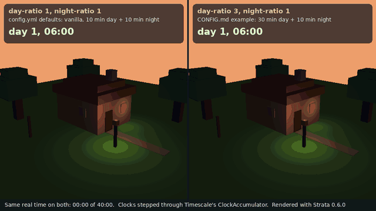

# Timescale

## Description

Timescale is a Minecraft plugin that slows the passage of in-game time. A vanilla day is twenty minutes, which means a player who logs on for an evening lives through a week. Timescale stretches the clock so that a day feels like a day.

It is deliberately the smallest plugin in this set: it turns off the vanilla daylight cycle and advances the clock itself, at whatever ratio the operator asks for.

This plugin was proposed from a Kingdom: First Era player request on 2026-09-04 ("slow timeline").

### Preview: the same forty minutes at two ratios

<picture>
  <source media="(prefers-reduced-motion: reduce)" srcset="docs/images/timescale-clock-poster.png">
  
</picture>

*Left: the default `config.yml` (`day-ratio: 1.0`, `night-ratio: 1.0`, vanilla). Right: `day-ratio: 3.0`, `night-ratio: 1.0`, the example in [CONFIG.md](CONFIG.md). Both clocks are stepped one server tick at a time through a copy of `ClockAccumulator`, and the sun follows Minecraft's own path (up at time 0, overhead at 6000, down at 12000). Rendered headless with [Strata](https://github.com/Preponderous-Software/strata) 0.6.0 by [`scripts/preview/render_clock.py`](scripts/preview/render_clock.py); the cottage and lantern are decoration.*

## Project Status

**In development, not yet released.** The clock is scaled with separate day and night ratios ([CONFIG.md](CONFIG.md)), the daylight-cycle gamerule is re-applied when a world loads, and sleeping still skips the night; commands are still to come. The scope of the first release is defined in [MVP.md](MVP.md).

## Planned Features

- A configurable time ratio — `3.0` makes a day take an hour
- Separate ratios for day and night
- Sleep that still works, instead of silently breaking
- A command to read and set the ratio at runtime

## Installation

Not yet released. Once there is a build, installation will follow the usual DPC pattern: drop the jar in `plugins/` and restart. It will also be available through [Dan's Plugin Manager](https://github.com/Dans-Plugins/Dans-Plugin-Manager).

### Dependencies

None.

## Usage

### Documentation

- [MVP](MVP.md) – Scope of the first release, and its deliberate non-goals
- [Configuration](CONFIG.md) – `config.yml` keys and defaults
- [Changelog](CHANGELOG.md) – User-visible changes

`USER_GUIDE.md` and `COMMANDS.md` land with the first release, per [DOCUMENTATION_PRACTICES.md](https://github.com/Dans-Plugins/dpc-conventions/blob/main/docs/DOCUMENTATION_PRACTICES.md).

## Support

You can find the support Discord server [here](https://discord.gg/xXtuAQ2).

### Experiencing a bug?

Please fill out a bug report [here](https://github.com/Dans-Plugins/Timescale/issues/new).

## Contributing

This repository follows the standards in [dpc-conventions](https://github.com/Dans-Plugins/dpc-conventions). `CONTRIBUTING.md` arrives with the build tooling.

## License

This project is licensed under the [GNU General Public License v3.0](LICENSE).

See the [LICENSE](LICENSE) file for full details.
